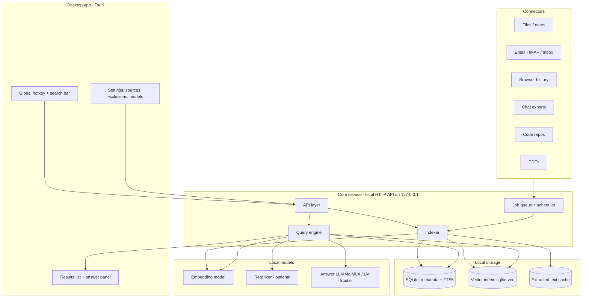
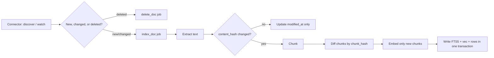
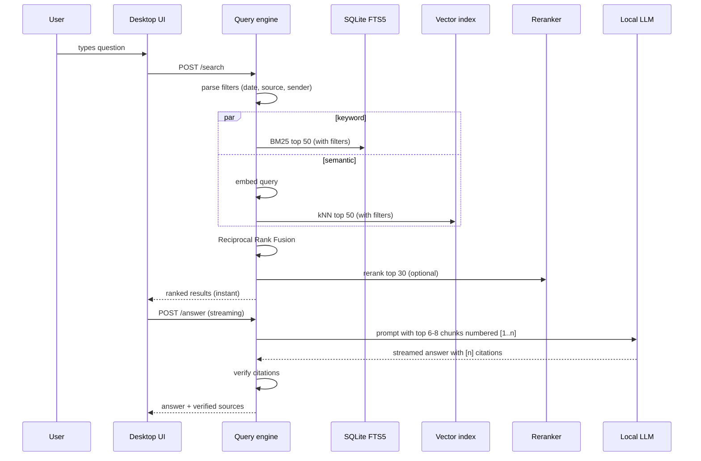

# PLAN.md: Private, Local-First Personal Search Engine

> A desktop app that indexes a user's personal data (notes, email, PDFs, browser history, chats, code) into one local index, searches it with hybrid keyword + semantic retrieval, and answers questions with a locally hosted LLM that cites its sources. No data leaves the device.

---

## 1. Goals and non-goals

### Goals
1. **One search box for your digital life:** files, notes, email, PDFs, browser history, chat exports, and code repositories.
2. **Hybrid retrieval:** BM25 keyword search for exact matches plus embedding search for matches by meaning, fused into one ranking.
3. **Incremental indexing:** new or changed items become searchable within seconds; nothing is rebuilt from scratch.
4. **Grounded answers:** a local LLM answers only from retrieved passages and cites each one; citations are verified before display.
5. **Privacy by design:** everything runs offline on the user's machine. No telemetry, no cloud calls.
6. **Runs well on a base MacBook Air (Apple Silicon, ~16 GB RAM, fanless).**

### Non-goals (v1)
- Training or fine-tuning any model.
- Multi-user / server deployment or sync between devices.
- Images, audio, and video understanding (only text; OCR only for scanned PDFs).
- Writing back to sources (no sending email, no editing notes).
- Mobile apps.

---

## 2. Target hardware and constraints

| Constraint | Implication |
|---|---|
| ~16 GB unified memory | ~11–11.5 GB usable for model weights (the ~70% rule); exact budget in §2.1, locked models in §4.1 |
| Fanless chassis | Long indexing throttles; batch work, rate-limit the background queue, pause on battery / high temperature |
| SSD | Index on local disk; SQLite in WAL mode is fast enough |
| Offline | All models downloaded once; app works with Wi-Fi off |

### 2.1 Memory budget

macOS and the LLM share one unified memory pool, so every model the app loads competes with the OS and the browser. Target machine: MacBook Air M5, 16 GB, 10-core, fanless. Budget in GB:

| Component | Idle | Indexing | Answering |
|---|---|---|---|
| macOS + apps | 5.0 | 5.0 | 5.0 |
| `llama-server` weights (Q5_K_M, 4B default) | — | — | 3.0 |
| KV cache (8k ctx, `q8_0`) | — | — | 0.6 |
| fastembed embedder (int8 ONNX) | — | 0.3 | — |
| SQLite page cache + indexer | 0.5 | 1.5 | 0.3 |
| Python core service + UI | 0.8 | 0.8 | 0.8 |
| **Total** | **6.3** | **7.6** | **9.7** |

Peak headroom is ~6.3 GB, which is the point: the LLM, the indexer, and a real browser can all be live at once on a fanless machine. The 8B quality opt-in (§4.1) adds 2.5 GB of weights and peaks at ~12.2 GB — comfortable, but no longer the everyday default.

Four things make this work and must not be changed casually:

- **`q8_0` KV cache** halves the KV cache's 1.2 GB to 0.6 GB. The 4B and 8B share GQA dimensions, so this saves the same absolute amount on both.
- **Context is capped at 8k**, not the 128k the model cards advertise. 32k KV would cost 4.7 GB and force swapping on a fanless chassis. The §8.2 prompt is only 3–4k tokens.
- **No PyTorch** (§4.1). `sentence-transformers` plus torch costs ~2.5 GB RSS, which is a third of the answering budget.
- **The 4B default is a deliberate choice, not a concession.** The LLM's only job is extractive summarization with citation tagging (§8.1): read 6–8 passages, answer, cite `[n]`, refuse if absent. No tools, no outside knowledge, no multi-step reasoning. The quality curve flattens early on that task, and the residual risk — citing a number that wasn't in the list, or leaking outside knowledge — is caught by §8.3 and surfaced in the UI rather than failing silently. `PLAN.md` §14.3 measures this rather than assuming it.

---

## 3. High-level architecture



### Components
| Component | Responsibility |
|---|---|
| **Desktop UI** | Hotkey, search bar, results, answer with citations, source settings, indexing progress |
| **Core service** | Long-running local process; owns the index, queue, and model calls; exposes a localhost-only HTTP API |
| **Connectors** | Discover items in a source, detect changes, yield raw items + metadata |
| **Extractor** | Turn raw items into clean text + structure (PDF pages, email headers, code symbols) |
| **Chunker** | Split text into passages with stable IDs and location pointers |
| **Indexer** | Write chunks to FTS5 and vector index; handle updates and deletions |
| **Query engine** | Parse query, filter, hybrid search, fuse, rerank, build prompt, verify citations |
| **Model runtime** | Embeddings + answer LLM behind an OpenAI-compatible local endpoint |

---

## 4. Tech stack

| Layer | Choice | Why | Alternatives |
|---|---|---|---|
| Desktop shell | **Tauri** (Rust + web UI) | Small binaries, native hotkey, cross-platform later | SwiftUI (Mac-only), Electron (heavier) |
| UI host | **Single static build of `app/ui`, two hosts** | Dev: FastAPI mounts `ui/dist` at `/`, develop in a browser at `127.0.0.1:8000` with no webview reload cycle and no build tooling. Ship: the Tauri window loads the identical assets in Phase 6. Nothing is rewritten at the boundary. | Two separate UIs (rejected), Tauri dev server throughout (rejected: pays webview reload cost across all six connectors) |
| UI | React + Tailwind | Fast to build | — |
| Core service | **Python 3.12 + FastAPI** | Best library ecosystem for parsing and ML runtimes | Rust (faster, slower to build) |
| Metadata + keyword index | **SQLite + FTS5** (BM25 built in) | Single file, transactional, zero setup | Tantivy |
| Vector index | **sqlite-vec** | Lives in the same SQLite DB; simple backup and deletes | LanceDB, FAISS |
| Embeddings | **`intfloat/multilingual-e5-base`, 768d** | Small, fast, multilingual, 768d matches the vec0 column. See §4.1 | `bge-small-en-v1.5` (lite), `bge-m3` (quality) |
| Embedding runtime | **fastembed** (ONNX Runtime int8) | No PyTorch, so no ~2.5 GB RSS tax. Batches 32 chunks comfortably on CPU | `sentence-transformers` + onnxruntime, MLX |
| Reranker | **`jina-reranker-v2-base-multilingual`** via fastembed `TextCrossEncoder` | Big precision gain on top-k. Interface reserved in Phase 2, enabled in Phase 3 | Skip in v1 |
| Answer LLM | **Qwen3-4B at Q5_K_M** via **llama.cpp `llama-server`** | Fits the §2.1 budget with ~6.3 GB headroom; the task (§8.1) is extractive, so a larger model buys little. `Qwen3-8B` Q5_K_M is the quality opt-in. See §4.1 | Gemma 4 E4B, Llama 3.1 8B |
| PDF | PyMuPDF (`fitz`); OCR fallback with Apple Vision or Tesseract | Fast, page-level positions | pdfplumber |
| HTML | `trafilatura` / readability | Clean main-content extraction | BeautifulSoup |
| Email | IMAP (`imapclient`) + `mailparser`, or local `.mbox` / Apple Mail files | Standard, offline after sync | Gmail API (needs OAuth, cloud) |
| Code parsing | **tree-sitter** | Split by function/class across languages | regex |
| File watching | `watchdog` (FSEvents on macOS) | Real-time change events | polling |
| Packaging | Tauri bundle + embedded Python (PyInstaller / `uv`) | One installable app | — |

### 4.1 Locked model configuration

These are the v1 defaults. Everything is config-driven, so any of it can be swapped without a code change — but changing a model invalidates part of the index (§16).

| Role | Model | Format / size | Runtime |
|---|---|---|---|
| Answer LLM (default) | `Qwen3-4B` Q5_K_M | GGUF, ~3.0 GB | llama.cpp `llama-server` |
| Answer LLM (quality opt-in) | `Qwen3-8B` Q5_K_M | GGUF, ~5.5 GB | llama.cpp `llama-server` |
| Embeddings | `intfloat/multilingual-e5-base` | 768d, ~280 MB int8 ONNX | fastembed |
| Reranker | `jina-reranker-v2-base-multilingual` | ~280 MB int8 ONNX | fastembed `TextCrossEncoder` |

**Two config facts that are load-bearing and were settled by measurement, not assumption.**

**1. Reasoning must be off.** Qwen3's chat template enables a reasoning mode by default,
and it is incompatible with §8.1 as written. Measured on the 4B: a 200-token ceiling was
consumed *entirely* by `reasoning_content`, so the answer came back truncated with
`finish_reason: "length"` and no citation at all — a silent correctness failure that looks
like a prompt bug. Disabling reasoning returned `finish_reason: "stop"` in 25 tokens with
the correct cited answer, and dropped time-to-first-token from 5.59 s to 0.27 s. So every
request carries `chat_template_kwargs: {"enable_thinking": false}`, and §14.3's §8.2 task
is extractive summarisation for which reasoning has nothing to contribute. It stays a
config flag (`llm_enable_thinking`) rather than a hardcoded constant so §14.3 can ablate
it.

**2. Quantized ONNX exports must be requested explicitly.** fastembed's catalog entry for
the reranker hardcodes the fp32 export (1.11 GB); the int8 export that the table above
budgets is 279.6 MB. Likewise fastembed has no catalog entry at all for
`multilingual-e5-base`. Both models are therefore registered with
`add_custom_model(...)` against an explicit quantized `model_file`, which is also how the
embedding model is pinned to the §5 dimension. Left on the catalog defaults, the indexing
state in §2.1 is roughly 830 MB heavier than budgeted.

> Note on the reranker licence: `jina-reranker-v2-base-multilingual` is CC-BY-NC-4.0.
> Fine for coursework; a commercial deployment would need a substitute.

**On model size.** The default is the 4B because §8.1 asks for very little: answer strictly from 6–8 numbered passages, cite `[n]`, refuse when the answer is absent. That is extractive summarization with citation tagging — no tools, no outside knowledge, no multi-step reasoning — and on that task the quality difference between 4B and 8B shows up mainly as citation-format discipline. `PLAN.md` §14.3 settles this by measurement rather than assumption: if the 4B's citation validity falls short of the Phase 4 target, the 8B becomes the default. Users who prefer quality over headroom can opt into the 8B in settings; it peaks at ~12.2 GB (§2.1), which is comfortable but not roomy.

The corpus is expected to be mostly English plus code. `multilingual-e5-base` is kept as the default for safety margin rather than dropped to an English-only model; §14.3 ablates the alternatives so the choice is measured, not assumed.

**`llama-server` invocation.** Pinned build in `scripts/`. The per-launch token from §9 doubles as the API key, so the LLM endpoint is not reachable by other local processes.

```bash
llama-server \
  -m models/qwen3-4b-Q5_K_M.gguf \
  --host 127.0.0.1 --port 8081 \
  --api-key "$STACKSEARCH_TOKEN" \
  -c 8192 -ngl 99 -np 1 \
  -ctk q8_0 -ctv q8_0 \
  --no-webui
```

`-np 1` because a single-user local app gains nothing from parallel slots. `-ctk/-ctv q8_0` are load-bearing for the §2.1 budget. The 8B opt-in swaps only the `-m` path.

**Runtime ruling.** §8.4 originally offered MLX, LM Studio, and Ollama as equals. They are not, and the plan now commits:

- **`llama-server` ships.** Single vendored binary, Metal, a real `/v1/chat/completions`, explicit control over context and KV-cache precision, and a clean idle-unload story. This is what satisfies §8.4's lazy-load and unload-after-idle requirements.
- **LM Studio and Ollama are accepted as user-supplied external endpoints** — any OpenAI-compatible `base_url` works. Both are good for development. Neither is a bundled dependency: LM Studio is a GUI app with manual model management and redistribution questions, and Ollama is an extra daemon with coarse model naming and no control over Q5 vs Q4.
- **MLX** is an optional embedding backend only, not the LLM runtime. It is fast on Apple Silicon but offers fewer quant choices.

**Two non-negotiables:**

1. **No PyTorch anywhere in the runtime or the venv.** fastembed covers all three models above via ONNX Runtime int8. This is a memory decision, not a preference: torch's ~2.5 GB RSS is a quarter of the §2.1 answering budget, and it cannot coexist with the LLM.
2. **Context stays at 8k.** Do not raise it to chase the advertised long context; the grounding prompt in §8.2 is 3–4k tokens.

**Pre-flight check, first task of Phase 0.** Confirm `intfloat/multilingual-e5-base` appears in `fastembed.list_supported_models()` with an ONNX export. If it does not, fall back in this order: `sentence-transformers` with the `onnxruntime` backend, then MLX. If all three are awkward, the honest alternative is `bge-base-en-v1.5` — it suits the English + code corpus and has the widest ONNX coverage.

> **Pre-flight result (Phase 0, measured).** It does *not* appear in the catalog — fastembed
> ships 37 ONNX text models and none is an e5 variant. The fallback chain is therefore not
> needed: `TextEmbedding.add_custom_model(...)` against an explicit quantized
> `model_file` runs `intfloat/multilingual-e5-base` at 768d on Apple Silicon with no
> torch, so the §4.1 default stands unchanged. Use `Xenova/multilingual-e5-base`'s
> `onnx/model_int8.onnx`; the official repo's only quantized export is
> `model_qint8_avx512_vnni.onnx`, which is x86-only and will not run on this hardware.
> The same registration pattern pins the reranker to its int8 export. Keep the fallback
> chain documented: it remains the correct response if a future fastembed drops
> `add_custom_model`.

> Model choices remain swappable by config. Re-check current small-model leaderboards before locking one in, and again at Phase 7 for the report.

---

## 5. Data model (SQLite)

```sql
-- One row per configured source (a folder, a mailbox, a browser profile...)
CREATE TABLE sources (
  id            INTEGER PRIMARY KEY,
  kind          TEXT NOT NULL,          -- files | email | browser | chat | code | pdf
  name          TEXT NOT NULL,
  config_json   TEXT NOT NULL,          -- paths, account, include/exclude globs
  enabled       INTEGER NOT NULL DEFAULT 1,
  last_sync_at  TEXT,
  cursor        TEXT                    -- connector-specific sync cursor (e.g. IMAP UIDVALIDITY:UID)
);

-- One row per logical item (a file, an email, a history entry, a chat thread)
CREATE TABLE documents (
  id            INTEGER PRIMARY KEY,
  source_id     INTEGER NOT NULL REFERENCES sources(id) ON DELETE CASCADE,
  external_id   TEXT NOT NULL,          -- path, Message-ID, URL+visit, thread id
  uri           TEXT NOT NULL,          -- how to open it: file://, message://, https://
  title         TEXT,
  author        TEXT,
  mime          TEXT,
  created_at    TEXT,
  modified_at   TEXT,
  content_hash  TEXT NOT NULL,          -- SHA-256 of extracted text
  status        TEXT NOT NULL DEFAULT 'indexed', -- pending | indexed | error | deleted
  error         TEXT,
  UNIQUE(source_id, external_id)
);

-- One row per passage
CREATE TABLE chunks (
  id            INTEGER PRIMARY KEY,
  document_id   INTEGER NOT NULL REFERENCES documents(id) ON DELETE CASCADE,
  ord           INTEGER NOT NULL,       -- order within the document
  text          TEXT NOT NULL,
  chunk_hash    TEXT NOT NULL,          -- lets unchanged chunks keep their embeddings
  loc_json      TEXT NOT NULL,          -- {"page":3} | {"line_start":40,"line_end":72,"symbol":"parseFoo"} | {"msg_part":"body"}
  token_count   INTEGER NOT NULL
);

-- Keyword index (BM25) over chunk text + title
CREATE VIRTUAL TABLE chunks_fts USING fts5(
  text, title,
  content='chunks', content_rowid='id',
  tokenize='porter unicode61'
);

-- Vector index (dimension set by the chosen embedding model)
-- NOTE: FLOAT[768] below is generated by the migration layer from
-- meta.embedding_dim, never hand-written. See the note after this schema.
CREATE VIRTUAL TABLE chunks_vec USING vec0(
  chunk_id INTEGER PRIMARY KEY,
  embedding FLOAT[768]
);

-- Background jobs
CREATE TABLE jobs (
  id            INTEGER PRIMARY KEY,
  kind          TEXT NOT NULL,          -- scan | index_doc | delete_doc | reembed
  payload_json  TEXT NOT NULL,
  priority      INTEGER NOT NULL DEFAULT 5,
  attempts      INTEGER NOT NULL DEFAULT 0,
  status        TEXT NOT NULL DEFAULT 'queued',
  run_after     TEXT
);

-- Optional: query log stored locally for evaluation (user can disable)
CREATE TABLE query_log (
  id INTEGER PRIMARY KEY, query TEXT, created_at TEXT,
  result_chunk_ids TEXT, clicked_chunk_id INTEGER, latency_ms INTEGER
);
```

Settings: `PRAGMA journal_mode=WAL;` so the UI can read while the indexer writes. Store the embedding model name + dimension in a `meta` table; if it changes, schedule a full re-embed.

**The vector dimension is never hardcoded.** The schema above shows `FLOAT[768]` because that is the §4.1 default, but the migration layer generates the `vec0` DDL by interpolating `meta.embedding_dim`. SQLite cannot `ALTER` a `vec0` column width, so a dimension change is a full table rebuild: drop `chunks_vec`, recreate at the new width, and enqueue a `reembed` job for every chunk. Setting a different embedding model without this step silently writes vectors of the wrong width and corrupts ranking — which is why the model id and dimension are stored together and checked on open.

---

## 6. Ingestion pipeline



### 6.1 Connector interface

```python
class Connector(Protocol):
    kind: str
    def scan(self, source: Source) -> Iterator[ItemRef]: ...          # full listing (first run, periodic reconcile)
    def watch(self, source: Source, emit: Callable[[Change], None]) -> None: ...  # real-time changes if supported
    def fetch(self, ref: ItemRef) -> RawItem: ...                     # bytes + metadata
    def open_uri(self, doc: Document) -> str: ...                     # deep link for the UI
```

### 6.2 Connectors (v1)

| Source | Discovery | Change detection | Notes |
|---|---|---|---|
| **Files / notes** (md, txt, docx, Obsidian vault) | Walk configured folders with include/exclude globs | FSEvents via `watchdog` + periodic mtime reconcile | Skip `node_modules`, `.git`, `.venv`, build dirs by default |
| **PDFs** | Same as files | Same | Page-level text; OCR fallback only if a page has no text layer |
| **Email** | IMAP over TLS, or local mbox / Apple Mail store | IMAP `UIDVALIDITY` + highest UID cursor; periodic flag sync for deletions | Credentials in macOS Keychain; index body + subject + from/to; skip attachments in v1 (or PDFs only) |
| **Browser history** | Copy the browser's history SQLite (Chrome `History`, Firefox `places.sqlite`, Safari `History.db`) to a temp file and read it | Last visit timestamp cursor | Index title + URL; optionally fetch and index page text for pages visited ≥ N times (opt-in, the only network use) |
| **Chats** | Import WhatsApp `.txt` exports, Telegram JSON, Discord exports | Re-import on file change | Chunk by time window per conversation |
| **Code** | Configured repo roots; respect `.gitignore` | FSEvents + `git` HEAD changes | tree-sitter split by function/class; keep path, symbol, line range |

### 6.3 Extraction rules
- Normalize to UTF-8, collapse whitespace, strip boilerplate (signatures, quoted email replies below "On … wrote:").
- Keep structure as metadata, not text: page numbers, headings, sender, symbol names.
- Hard limits: skip files > 50 MB, binaries, and anything matched by exclusions. Record skipped items with a reason.

### 6.4 Chunking strategy

| Content | Strategy | Target size |
|---|---|---|
| Prose (notes, PDFs, web pages) | Split on headings/paragraphs, then pack to size with ~15% overlap | ~300–500 tokens |
| Email | One chunk per message body (split if long); subject + sender prepended | ≤ 500 tokens |
| Chat | Sliding time windows per conversation (e.g. 20 messages) | ≤ 400 tokens |
| Code | One chunk per function/class; small files whole; header line with path + symbol | ≤ 600 tokens |
| Browser history | One chunk per URL (title + URL + optional page text summary) | small |

Each chunk text sent to the embedding model is prefixed with a short context header, e.g. `[email] From: recruiter@… Subject: Offer details`, which improves retrieval noticeably.

### 6.5 Incremental indexing
1. **Document level:** compare `content_hash` of freshly extracted text with the stored one. Same hash means nothing to do.
2. **Chunk level:** re-chunk the changed document, compare `chunk_hash` values, keep rows and embeddings for unchanged chunks, embed only new ones, delete removed ones.
3. **Deletions:** watcher delete events and periodic reconcile scans mark documents `deleted` and cascade-remove their chunks from FTS5 and the vector index.
4. **Atomicity:** each document update is one SQLite transaction, so search never sees half-indexed documents.
5. **Reconcile:** a low-priority full scan runs daily to catch events missed while the app was closed.

### 6.6 Job queue and thermal policy
- Single-process priority queue persisted in `jobs` (survives restarts).
- Priorities: user-triggered reindex > live changes > first-time bulk indexing > reconcile.
- Embedding in batches (e.g. 32 chunks).
- Throttling: pause bulk work when on battery below a threshold, when the user is actively querying, or when the OS reports thermal pressure; resume automatically.
- Retries with exponential backoff; after 3 failures mark the document `error` and surface it in settings.

### 6.7 Resident-memory gate

Thermal and battery policy is necessary but not the binding constraint. The constraint that actually decides behaviour is §2.1: only **one model group resident at a time**. The three states in that budget table are exclusive by design, so the indexer and the LLM can never be resident together.

States and transitions:

1. **Indexing** — embedder and reranker resident, `llama-server` evicted, queue running at low priority.
2. **Query arrives** — indexer pauses within one batch (32 chunks, so at most ~0.5 s of extra latency), SQLite page cache is trimmed, embedder is evicted, and `llama-server` is spawned lazily if not already up.
3. **Answering** — LLM resident, indexer queue stays paused until the answer stream closes.
4. **Idle** — after `llm.unload_after_idle_minutes` (default 60), the `llama-server` process is killed to reclaim ~6.1 GB. The next query pays the cold start.

Default is *keep resident*, because the §2.1 budget allows it; process-kill only happens on the idle timeout. Killing on every transition instead would pay the ~4 s cold start on every search session, which defeats §7.4's two-speed design.

The gate is advisory rather than mandatory — it prefers to pause the queue over evicting a model the user is actively using.

---

## 7. Query pipeline



### 7.1 Query understanding (rule-based first)
- Date phrases ("last week", "in March", "2025") become a date range via a parser like `dateparser`.
- Source hints ("email", "in my notes", "PDF", "code") become a `source.kind` filter.
- People ("from Rahul", "recruiter") match the `author` field.
- Quoted phrases are passed as exact phrase queries to FTS5.
- Optional v2: a small LLM call turns the question into structured filters as JSON, validated against a schema; fall back to rules if invalid.

### 7.2 Hybrid retrieval and fusion
- BM25: `SELECT rowid, bm25(chunks_fts) FROM chunks_fts WHERE chunks_fts MATCH ? ORDER BY rank LIMIT 50` joined with metadata filters.
- Vector: embed the query, kNN against `chunks_vec`, top 50, then apply the same filters.
- **Reciprocal Rank Fusion:** `score(d) = Σ 1 / (k + rank_i(d))` with `k = 60`. Simple, no score normalization needed.
- Small boosts: recency (for email/chat), title matches, and documents the user clicked before (local signal only).
- De-duplicate: keep at most 2 chunks per document in the top results so one long PDF doesn't drown everything.

### 7.3 Reranking (optional, Phase 3)
A small cross-encoder rescores the top ~30 fused candidates against the query. Biggest precision win for question-style queries. Skip when the query is a short keyword lookup.

### 7.4 Two-speed results
- **Results list** returns immediately after retrieval (target < 300 ms).
- **Answer** streams afterwards. Users can ignore it and just click results, like a normal search engine.

---

## 8. LLM layer (grounded answering)

The LLM never searches and never sees the whole index. It only writes an answer from the passages retrieval selected.

### 8.1 Prompt template

```
SYSTEM:
You answer questions using ONLY the numbered sources below, which come from the
user's own files. Cite every factual claim with the source number in square
brackets, like [2]. If the sources do not contain the answer, say
"I couldn't find that in your data." Do not use outside knowledge. Be concise.

SOURCES:
[1] (email, 2026-09-12, from: hr@company.com, "Offer letter") <chunk text>
[2] (note, 2026-09-14, notes/internship.md) <chunk text>
...

QUESTION: <user question>
```

The system prompt also states that the sources are data rather than instructions (§9), and
the model must be sampled with **reasoning disabled** — see the second config fact in §4.1.
Qwen3 emits a `reasoning_content` block by default that consumes the token budget before
any answer or citation is produced, which defeats the citation verification in §8.3 by
leaving nothing to verify.

### 8.2 Context budget
- Fit 6–8 chunks (~3–4k tokens) to keep latency low on the default 4B model.
- Order sources by fused score; trim chunks to their most relevant sentences if the budget is exceeded.

### 8.3 Citation verification
1. Parse every `[n]` in the output.
2. Reject citation numbers that weren't provided; strip them and flag the sentence.
3. Optional check: for each cited sentence, confirm lexical or embedding overlap with the cited chunk above a threshold; mark weakly supported sentences in the UI.
4. If the answer has no valid citations, show "No grounded answer" and just the results list.

### 8.4 Runtime
- Models are served by llama.cpp `llama-server` behind an OpenAI-compatible endpoint on `127.0.0.1`. LM Studio and Ollama are accepted as user-supplied external endpoints; see the runtime ruling in §4.1 for why `llama-server` is the one that ships.
- Core service talks only to that endpoint, so swapping models is a config change.
- Model loaded lazily on first question, unloaded after idle timeout to free RAM (§6.7).

---

## 9. Privacy and security

| Area | Design |
|---|---|
| Network | Core service binds to `127.0.0.1` only; no telemetry; app works with networking off. The only optional network use is IMAP sync and opt-in page fetching, each clearly labelled |
| API access | Random per-launch token required by the local API, so other local processes and web pages can't query it |
| Storage | Index in `~/Library/Application Support/<app>/`; optional encryption at rest with SQLCipher, key stored in macOS Keychain |
| Credentials | IMAP passwords / app passwords stored in Keychain, never in config files |
| Permissions | macOS Full Disk Access requested only when a source needs it (e.g. Safari history, Mail) with an explanation |
| Exclusions | Exclude folders, file types, email senders, domains; built-in defaults for secrets (`.env`, `id_rsa`, `*.pem`, password manager exports) |
| Secret scrubbing | Regex detector for API keys / tokens at chunk time; matching spans are redacted from the index |
| Deletion | "Forget source" removes all documents, chunks, vectors, and cached text, then runs `VACUUM` |
| Prompt injection | Retrieved text is data, not instructions; system prompt says so; LLM has no tools, so injected text can't trigger actions |

---

## 10. Local API (core service)

| Method | Path | Purpose |
|---|---|---|
| GET | `/status` | Index stats, queue length, model status |
| GET | `/sources` | List sources |
| POST | `/sources` | Add a source `{kind, name, config}` |
| PATCH | `/sources/{id}` | Enable/disable, edit exclusions |
| DELETE | `/sources/{id}` | Forget a source and all its data |
| POST | `/sources/{id}/reindex` | Force rescan |
| POST | `/search` | `{query, filters?, limit?}` returns ranked results with snippets |
| POST | `/answer` | `{query, result_ids?}` streams answer tokens + final citations (SSE) |
| GET | `/documents/{id}` | Metadata + open URI |
| GET | `/events` | SSE stream of indexing progress for the UI |

Search response shape:

```json
{
  "results": [
    {
      "chunk_id": 1842,
      "document_id": 311,
      "source_kind": "email",
      "title": "Offer letter",
      "author": "hr@company.com",
      "date": "2026-09-12",
      "snippet": "…your start date will be <mark>November 3</mark>…",
      "uri": "message://%3Cabc123%40company.com%3E",
      "loc": {"msg_part": "body"},
      "score": 0.0331,
      "signals": {"bm25_rank": 2, "vec_rank": 1}
    }
  ],
  "latency_ms": 142
}
```

---

## 11. UI and user flow

### 11.1 First run
1. Welcome screen explaining what stays local.
2. Choose sources (checkbox list) and folders; sensible exclusions pre-filled.
3. Download / select models. Defaults are the §4.1 locked set, where the answer LLM is the 4B; a setup toggle offers the 8B quality opt-in alongside it. Advanced settings allow a different GGUF, embedding model, or reranker, or pointing at an existing LM Studio / Ollama endpoint.
4. Indexing starts; progress per source; search is usable immediately on what's indexed so far.

### 11.2 Daily use
1. Global hotkey opens a Spotlight-style bar.
2. Type, get results instantly; filter chips for source and date.
3. Answer panel streams a cited answer above results; hovering a citation shows the passage; clicking opens the original (file at line, PDF at page, email in Mail).
4. Keyboard first: arrows to move, Enter to open, Tab to switch between results and answer.

### 11.3 Settings
Sources and exclusions, models, indexing schedule and thermal policy, encryption, "forget source", query log toggle, export diagnostics (no content).

---

## 12. Project structure

```
stacksearch/
├── PLAN.md
├── app/                     # Tauri desktop app (built out in Phase 6)
│   ├── src-tauri/           # Rust: global hotkey, vibrancy window, menu-bar item,
│   │                        #   spawn + supervise the Python core service, and open
│   │                        #   sources (file.pdf#page=3, notes.md:40:72, message://<id>)
│   └── ui/                  # React + Tailwind, one static build. In Phases 1-5 the core
│                            #   service mounts this at / and it is developed in a
│                            #   browser at 127.0.0.1:8000. In Phase 6 the same built
│                            #   assets become the Tauri frontend dist. Nothing is
│                            #   rewritten at the boundary — do not fork the UI per host.
├── core/                    # Python core service
│   ├── api/                 # FastAPI routes
│   ├── connectors/          # files.py, pdf.py, email_imap.py, browser.py, chat.py, code.py
│   ├── extract/             # pdf, html, email, code (tree-sitter)
│   ├── chunking/
│   ├── index/               # sqlite schema, fts, vec, migrations
│   ├── query/               # parser, hybrid, fusion, rerank
│   ├── llm/                 # client, prompts, citation verifier
│   ├── jobs/                # queue, scheduler, thermal + resident-memory gate (§6.7)
│   ├── privacy/             # exclusions, secret scrubber, keychain
│   └── config.py
├── eval/                    # datasets, scripts, reports
├── tests/
└── scripts/                 # dev setup, model download, llama-server build pin, packaging
```

---

## 13. Build phases (one semester, ~12–14 weeks)

| Phase | Weeks | Deliverable | Done when |
|---|---|---|---|
| **0. Setup** | 1 | Repo, schema, core service skeleton, model runtime running, Tauri skeleton proving the integration | `/status` responds correctly **from a script and from a Tauri window**; `rustup` + Tauri v2 scaffolded; the global hotkey summons the window; the Rust side spawns and supervises the Python core service and reads its `/events` SSE stream; embeddings + LLM answer from a script. No real UI yet — raw JSON in the window is fine. |
| **1. Files + keyword search** | 2–3 | Files/notes/PDF connectors, extraction, chunking, FTS5 BM25, CLI search. UI developed in the browser. | Search a 5k-file folder in < 200 ms |
| **2. Semantic + hybrid** | 4–5 | Embeddings, sqlite-vec, RRF fusion, filters | Hybrid beats BM25-only on the eval set |
| **3. Incremental indexing** | 6 | Watchers, hashes, chunk diffing, deletes, job queue, reconcile, resident-memory gate (§6.7) | Edit a note and it's searchable in < 5 s; deletes disappear |
| **4. Grounded answers** | 7–8 | Prompt, streaming, citation verification, reranker | ≥ 90% of answers have only valid citations on eval set |
| **5. More sources** | 9–10 | Email (IMAP/mbox), browser history, chat exports, code via tree-sitter | All six source types indexed |
| **6. Desktop app** | 11–12 | Tauri UI, hotkey, results, answer panel, settings, progress | Full user flow without the terminal |
| **7. Privacy + polish + eval** | 13–14 | Encryption, secret scrubbing, exclusions, evaluation report, demo | Report + demo video ready |

**Minimum viable demo (if time runs short):** Phases 0–4 with files + PDFs + one more source. Phases 0–4 are deliberately reachable with no Rust work after week 1, because the UI is developed in a browser against the same static assets (§4 UI host row, §12).

### 13.1 Why Tauri is integrated in Phase 0 rather than Phase 6

Phase 6 originally introduced Tauri at week 11. That ordering is backwards: every risky unknown in the desktop integration — spawning and supervising a Python child process from Rust, the §9 localhost token handshake, SSE streaming through WKWebView, opening `file://` deep links — would all be discovered in week 11, one week before they were needed, with no slack to absorb surprises.

Phase 0 therefore builds a skeleton Tauri window that renders `/status` JSON. It is a day or two of work, and it converts Phase 6 from "integrate Tauri and build the UI" into "build the real UI against an integration that is already proven." Phases 1–5 then develop the UI in a browser at the same localhost endpoint, so the risk is retired early while the schedule is still forgiving.

---

## 14. Evaluation

### 14.1 Dataset
- Build a **synthetic personal corpus** for reproducible demos and grading (fake emails, notes, PDFs, chat logs, a small repo), so no real private data appears in the report.
- Write 100+ questions with known answer passages, split by type: exact lookup ("order ID 48213"), meaning-based ("that article about storage pricing"), time-filtered ("emails from last week about the offer"), and unanswerable questions.

### 14.2 Metrics
| Area | Metric |
|---|---|
| Retrieval | Recall@10, MRR, nDCG@10 for BM25-only vs vector-only vs hybrid vs hybrid+rerank |
| Answers | Citation validity rate, faithfulness (claims supported by cited chunk), correct refusal rate on unanswerable questions |
| Freshness | Time from file save / email arrival to searchable |
| Performance | Search p50/p95 latency, answer time-to-first-token, indexing throughput (chunks/min), peak RAM |
| Resource | Battery drain and thermal throttling during bulk indexing |

### 14.3 Ablations to report
- Hybrid vs each method alone.
- With vs without reranker.
- Chunk size 256 vs 512 vs 1024 tokens.
- With vs without context headers on chunks.
- Three embedding models, to make the §4.1 choice evidence rather than assumption:
  - `multilingual-e5-base` 768d (the default),
  - `bge-base-en-v1.5` 768d (English-only; the corpus is mostly English plus code),
  - `bge-small-en-v1.5` 384d (low-power / battery mode, and the dimension-rebuild path from §5).
- **Answer LLM size — the one that decides the default.** `Qwen3-4B` Q5_K_M against `Qwen3-8B` Q5_K_M, scored on citation validity rate, correct refusal rate, faithfulness, and time-to-first-token. If 4B holds the Phase 4 bar, it stays the default; if not, the 8B is promoted. This ablation is what justifies §4.1's choice rather than leaving it as a guess.
- `q8_0` KV cache on vs off, to measure the §2.1 memory claim directly rather than trusting it.

---

## 15. Testing

- **Unit:** extractors (fixture files per type), chunker boundaries, hash diffing, RRF math, date parser, citation parser.
- **Integration:** index a fixture corpus, modify/delete files, assert index state; end-to-end `/search` and `/answer` with a mocked LLM.
- **Golden tests:** fixed questions with expected top results; fail CI if Recall@10 drops.
- **Privacy tests:** assert no outbound network calls during indexing/search (run with networking blocked); assert excluded paths never appear in the DB; assert secrets are redacted.
- **Performance tests:** index 10k / 50k chunks and record latency and memory.

---

## 16. Risks and mitigations

| Risk | Mitigation |
|---|---|
| LLM hallucinates | Strict grounding prompt, citation verification, refusal path, results always visible |
| Memory pressure while answering | The 4B default peaks at ~9.7 GB of 16 GB (§2.1). `q8_0` KV cache, 8k context cap, and embedder eviction via the §6.7 gate. The 8B opt-in peaks at ~12.2 GB — still fits, but swap risk rises if a browser tab spikes. Measured, not assumed — see §14.3. |
| 4B quality floor is too low | The default model may miscite or leak outside knowledge on the §8.1 grounding task. §8.3 strips invalid `[n]` and flags unsupported sentences, so failures are visible rather than silent, and the Phase 4 eval gates on ≥ 90% citation validity. If 4B misses that bar, promote the 8B to default — the fallback chain is a config change. |
| PyTorch pulled in transitively | ONNX-only stack: fastembed for embeddings and reranking. CI asserts `torch` is absent from the venv. This is a memory decision — torch's ~2.5 GB RSS does not coexist with the LLM (§2.1). |
| Thermal throttling / battery drain | Batched, throttled background queue; pause on battery; lazy model loading |
| Huge corpora slow down | Exclusion defaults, skip big binaries, per-doc chunk caps, SQLite tuning, ANN index if needed |
| macOS permissions block sources | Clear onboarding for Full Disk Access; graceful degradation per source |
| Email setup friction (OAuth) | Support IMAP app passwords and local mbox/Apple Mail first |
| Embedding model change invalidates index | Store model id + dim in `meta`; background re-embed job |
| Scope creep | Phases with a defined minimum viable demo; images/audio explicitly out of scope. Third toolchain (Rust) is confined to a Phase 0 skeleton and a small fixed command surface, not carried through all six connectors (§4 UI host row). |
| Sensitive data in the report | Synthetic evaluation corpus only |

---

## 17. Stretch goals (after v1)

- Image search via local captioning or CLIP-style embeddings for screenshots and photos.
- Audio notes and meeting recordings via local Whisper transcription.
- "Timeline" view: what you worked on on a given day across all sources.
- Conversational follow-ups that keep the previous retrieval context.
- Plugin SDK for third-party connectors (Notion export, Slack export, Calendar `.ics`).
- Linux/Windows builds (Tauri makes this mostly a connector problem).
- Encrypted backup of the index to an external drive.

---

## 18. Glossary

- **BM25:** keyword ranking that scores documents by how often query words appear, weighting rare words more and normalizing for length.
- **Embedding:** a vector of numbers representing a passage's meaning; similar meaning gives nearby vectors.
- **Hybrid search:** running keyword and vector search together and merging the results.
- **RRF (Reciprocal Rank Fusion):** merges ranked lists by summing `1 / (k + rank)` for each item.
- **Reranker:** a model that reads the query and a candidate passage together and scores relevance more precisely.
- **Incremental indexing:** updating only items that changed, detected by hashes and change events.
- **Grounded generation (RAG):** an LLM writes an answer using only retrieved passages and cites them.
- **MLX:** Apple's machine-learning framework optimized for Apple Silicon. Available as an optional embedding backend in this project, but not the LLM runtime — see §4.1.
- **Q4_K_M / Q5_K_M:** GGUF quantization levels. `K_M` keeps most layers at higher precision and quantizes the rest to medium, which is the best quality per byte on Apple Silicon. Roughly 0.6 GB of file size per billion parameters per level, so Q5_K_M is ~3.0 GB for a 4B model and ~5.5 GB for an 8B — the difference is the whole §2.1 budget.
- **KV cache:** the per-token attention state the model keeps for every token it has seen. Its size grows with context length, not model size, which is why it is the thing to shrink before shrinking the weights.

---

## 19. One-line summary for the proposal

A private, locally hosted search engine that indexes a user's personal data (notes, emails, PDFs, browser history, and code) using hybrid keyword and semantic search, and answers questions with a local language model that cites the original sources, all without data ever leaving the device. The LLM runs locally and only generates answers: the system first retrieves the most relevant passages from the user's data, then the model writes a concise answer grounded strictly in those passages, citing each source it used.

